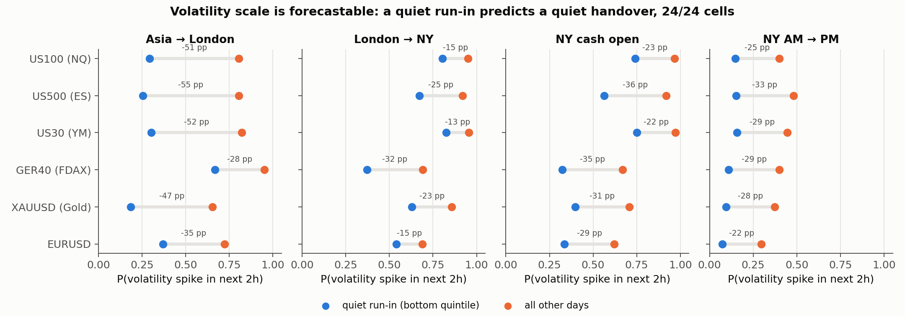
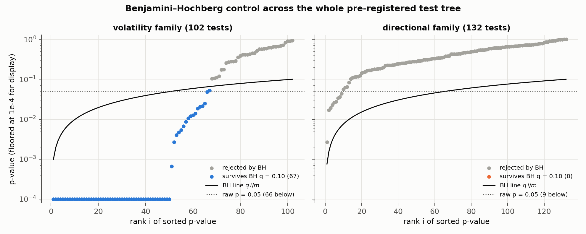
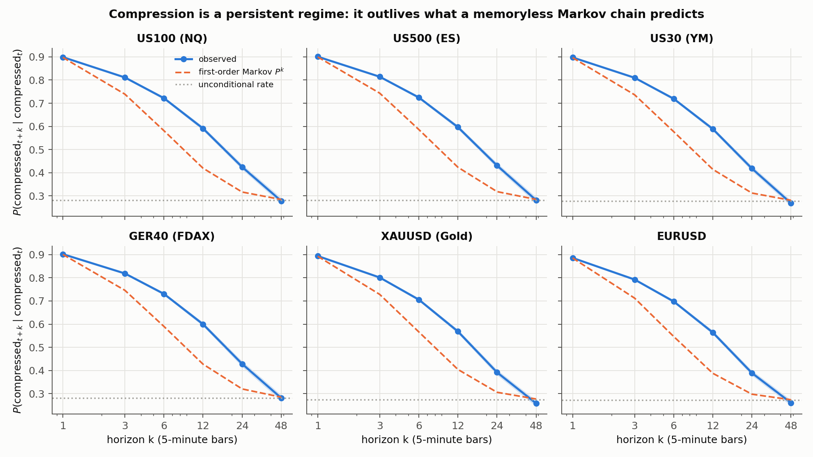
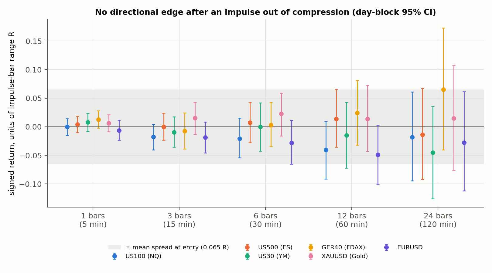

# Intraday Volatility Regimes: What Is Forecastable and What Is Not

**A pre-registered, 330-test research programme on six markets (NASDAQ-100, S&P 500, Dow, DAX, gold, EUR/USD) asking whether "volatility compression" carries information, and whether that information is about the *size* of the next move or its *direction*.**

5-minute bars from January 2022 to July 2026, roughly 320,000 bars per instrument, with every result corrected for multiple testing.



## Headline findings

1. **Volatility *scale* is strongly forecastable 1 to 3 hours ahead.** A quiet hour going into a session handover (Asia → London, London → New York, the cash open, NY morning → afternoon) cuts the probability of a volatility spike in the next two hours by **13 to 55 percentage points**. The effect is significant in **24 of 24** instrument × boundary cells (day-block bootstrap 95% CI entirely below zero).
2. **Compression is a persistent regime, not a memoryless state.** The probability of still being compressed one hour later exceeds what a first-order Markov chain predicts by **+0.16 to +0.18** on every instrument.
3. **No directional effect survives.** 132 pre-specified directional tests produced 9 raw p < 0.05, against 6.6 expected by chance, and **0 survive** Benjamini–Hochberg at q = 0.10. In the volatility family, **67 of 102** survive.
4. **The structural reason.** When a session is going to be quiet, everything shrinks together: the opening range, the excursions and the reversal distances all scale down in the same proportion. A forecast that is excellent for *scale* therefore says almost nothing about *path shape*, and directional edge lives in shape.



## Methodology

### 1. Deseasonalised volatility

A raw ATR percentile on index CFDs is mostly a clock: 93 to 96% of "compressed" bars on NQ/ES/YM fell in the Asian session. Each bar is therefore scaled by the volatility normally seen *at that time of day*:

```math
\text{ATR}_t = \tfrac{13}{14}\,\text{ATR}_{t-1} + \tfrac{1}{14}\,(H_t - L_t)
```

```math
S_\tau(t) = \mathrm{median}\left\{\text{ATR}_u \;:\; \tau(u)=\tau(t),\ u \in \text{previous 60 sessions}\right\}, \qquad \text{abn}_t = \frac{\text{ATR}_t}{S_\tau(t)}
```

where $`\tau(\cdot)`$ is the New York 5-minute slot. The baseline is shifted one session so that today never contributes to its own expectation. States come from a causal 100-bar percentile rank:

```math
\pi_t = \sum_{j=0}^{99} \mathbf{1}\left[\text{abn}_{t-j} \le \text{abn}_t\right] \;\;(\%\text{ of the trailing 100 bars}), \qquad
\text{state}_t = \begin{cases} \text{compressed} & \pi_t < 20 \\ \text{normal} & 20 \le \pi_t \le 80 \\ \text{high} & 80 < \pi_t \le 95 \\ \text{extreme} & \pi_t > 95 \end{cases}
```

Every feature at bar $`t`$ uses only information available at the close of $`t`$.

### 2. Persistence against explicit nulls

```math
\hat P_k = P(\text{compressed}_{t+k} \mid \text{compressed}_t) \quad\text{vs}\quad \left(\mathbf{P}^k\right)_{cc}
```

where $`\mathbf{P}`$ is the estimated one-step transition matrix. If states were Markov the two would match, so the gap between them is memory that a Markov model misses. The unconditional rate and an i.i.d. surrogate (the range series randomly permuted) give the floor. Deseasonalising before defining states is what removes the time-of-day confound.



### 3. Session-handover test
One observation per boundary per day, so time of day is controlled exactly:
* **pre-window:** the 12 bars (1 h) ending at the boundary. "Quiet" means bottom quintile of pre-window `abn` for that boundary.
* **outcome:** a clock-referenced spike, $`\max_{j \le 24} \text{range}_{t+j} / S_\tau(t+j) \ge 2`$, within the next 2 hours.
* **inference:** a day-block bootstrap of $`\hat p_{\text{quiet}} - \hat p_{\text{rest}}`$, resampling whole sessions (3,000 draws) so that intraday dependence cannot shrink the interval.

Elsewhere, effects are compared with a **matched baseline**: direct standardisation on (5-minute slot × calendar month), with numerator and denominator bootstrapped together over days.

### 4. Multiple-testing control
All 330 tests are registered in `results/research_log.json`, each with its hypothesis, definition, control, sample size, p-value and an explicit `prespecified` flag (282 pre-specified, 48 exploratory). Pre-specified p-values are controlled with Benjamini–Hochberg:

```math
k^\ast = \max\left\{ i : p_{(i)} \le \frac{q\,i}{m} \right\}, \qquad \text{reject } H_{(1)},\dots,H_{(k^\ast)}, \qquad q = 0.10
```

applied separately to the volatility and directional families.

### 5. Directional test
Event: an impulse bar emerging from compression ($`\pi_{j-1} < 20`$ and $`\text{range}_j / S_\tau(j) \ge 2`$). Direction $`d = \mathrm{sign}(C_j - O_j)`$, entry at the *next* bar's open, return measured in units of the impulse bar's own range $`R_j`$ so that costs sit on the same axis:

```math
r_{j,k} = \frac{d\,(C_{j+k} - O_{j+1})}{R_j}, \qquad k \in \{1,3,6,12,24\}
```



Every confidence interval straddles zero, and every point estimate sits inside the spread band (mean spread at entry = 0.065 R).

## Data integrity

Three traps were caught and handled before any statistics were run (details in `scripts/r00_prep.py`):
* **The "M5" history is hourly before 2022** for US100, US500 and GER40, because MT5 silently serves coarser bars in deep history. Everything before 2022-01-01 is dropped.
* **Broker timestamps are wall-clock EET/EEST, not UTC.** A fixed-offset conversion is wrong for about 4 weeks a year, so timestamps are converted through the tz database.
* **The broker's contract-spec CSV is column-shifted**, so point sizes are asserted from observed price precision instead of being read from it.

## Limitations

* CFD data from one retail broker, with tick volume only and no order-flow information.
* The 2025 to 2026 period is inside the sample. The forecasts are stated with explicit falsification criteria in `FINDINGS.md` for testing on data after 2026-07-29.
* The forecastable quantity is volatility, which a CFD account cannot trade directly. Its value is in **risk**: position sizing, stop distance, and switching a strategy off on days it will not cover its spread.

## Repository layout

```
scripts/
  r00_prep.py          raw MT5 export -> clean, clock-correct M5 panel
  r0_features.py       causal feature panel: ATR, seasonal baseline, abn, states, episodes
  r1_persistence.py    state persistence vs Markov and surrogate nulls
  r2_transitions.py    what happens when a compression episode ends
  r3_conditional.py    depth / duration conditioning, matched baselines
  r4_sessions.py       session-handover forecasts (headline result)
  r5_directional.py    every directional hypothesis (parts 7-10)
  r6_consequence.py    year-by-year stability, causal (trailing) flag, monetisability
  r7_orfade.py         exploratory lead (flagged as such): opening-range fade
  r8_summary.py        multiple-testing accounting over the whole tree
  vol_core.py, stats_util.py, research_log.py   shared primitives
results/               JSON outputs, research_log.json, logs/ (console output of every stage)
figures/make_figures.py   rebuilds all figures from results/ (no broker data needed)
notebooks/walkthrough.ipynb   executed walkthrough: BH control, persistence, session tables
FINDINGS.md            the full 17-part research write-up
```

## Reproducing

```bash
pip install -r requirements.txt
python figures/make_figures.py
jupyter notebook notebooks/walkthrough.ipynb
```

Full pipeline from raw bars (format in [`data/README.md`](data/README.md)):

```bash
export BROKER_DATA_DIR=/path/to/mt5/export
cd scripts
for s in r00_prep r0_features r1_persistence r2_transitions r3_conditional \
         r4_sessions r5_directional r6_consequence r7_orfade r8_summary; do python -u $s.py; done
```

Seeds are fixed. The full pipeline was re-run end to end from a clean copy, and the outputs in `results/` are from that run.

---
*Author: Muhammad Talal Malik · Business Data Analytics, COMSATS University*
